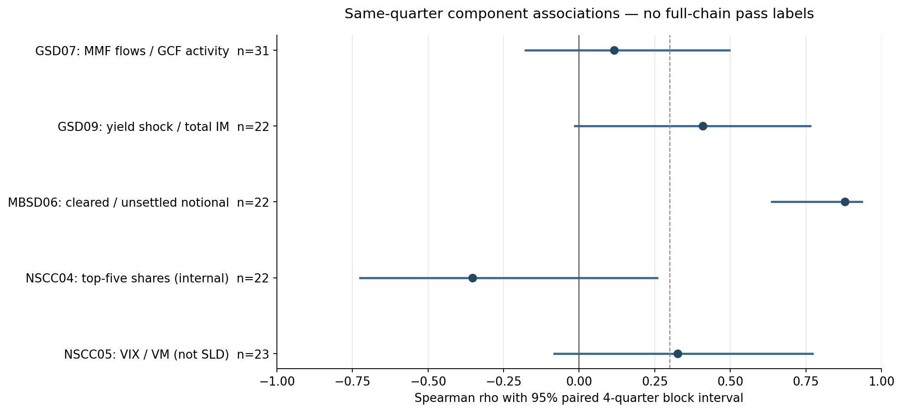
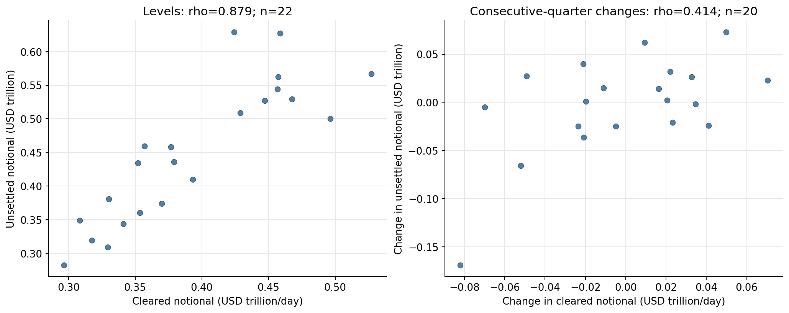

# 31 条新增传导链：检验汇总

2026-10-21 · 定义 v3 · 探索性分析

**31 条均完成数据与证据核对，但并非 31 条都能做数值检验。** 10 条运行了部分事件筛查、关联或内部诊断；4 条仅做案例/条件核对；17 条仍缺专属数据。尚无新增链完成整条链验证。这不意味着 31 条链全部无效。

7 条链运行事件筛查，复用 5 个信号；其中 5 条链的信号达到旧筛查门槛，实际上只涉及 3 个不同信号（融资、国债收益率变化、VIX）。8 种关联/诊断规格覆盖 7 条链，包括一项补充规格和一项内部诊断。不能把重复使用的信号或替代结果算成新的独立验证。

## 主要发现

- **拍卖供给→GSD 总交收**：同月变化 ρ=0.578，95% 区间 [0.451,0.688]，n=104 月。控制月份效应的 OLS-HAC p=0.204，稳健性不足；测量的是总业务吞吐，不是拍卖交收故障。
- **MBSD 活动→未交收头寸**：水平 ρ=0.879，区间 [0.638,0.936]，n=22 季；连续季度差分 ρ=0.414，后期水平 ρ=0.257。剔除两期清算额单位修正值后，水平 ρ=0.865、差分 ρ=0.268。关联值得继续研究，但仍缺独立外部冲击与真正的 TBA 远期管道。
- **利率→GSD 总保证金**：ρ=0.408，区间 [-0.014,0.764]，n=22，未达旧关联门槛；缺期货端和跨保证金账户数据。
- **融资压力→GCF 价格**：HAC 系数 0.021 bp、p=0.976，n=246 日；不支持该代理规格，也不能据此否定抵押品/资金交收机制。
- **NSCC 流动性**：VIX→VM 峰值 ρ=0.326，但区间跨零。VM 不是 SLD；下一季度 ρ=0.408 是单独的次要结果，不能取代主规格。
- 非美联储三方回购收缩没有命中预设四个压力窗口；商业票据利差信号只命中两个窗口之一。保留结果，不换窗口追求通过。

## 方法与边界

沿用旧方法：阈值仅用历史数据，日度为前252个有效观测的90分位、周度为前52周峰值的90分位；事件至少可观察两次、命中率至少2/3、非事件预警代理比例不超过15%，日度还要求事件内预警比例中位数至少25%。“非事件预警”不是真实误报率：事件清单不穷尽。

关联以同季度为主、下一季度为次；季度配对四季区块 bootstrap 2,000次，月度十二个月区块，固定种子20261016。旧季度门槛为 n≥12、ρ≥0.3、95%下界>0；新增月度规格要求n≥36。6项主规格做BH校正，普通p值/BH本身不校正时间依赖；依赖不确定性主要由区块区间/HAC体现。内部诊断和补充规格单列，不参与主规格选择。

方案在新相关性计算前固定，但旧结果和历史事件已知，因此不是预注册，也无盲测留出集。辅助数据使用当前修订/最终版本；下一期配对仅为描述性领先滞后关系，尤其联储季度流量有发布滞后，不能当成真实时间预测能力。当前规则只说明可行机制，不能追认历史年份已适用同一规则。

框架仍为 S×V，不加 E 乘数。相关性检验不是脆弱度打分；没有为新增服务臆造V、权重、损失概率或机器学习风险分数。

## 数据核对与覆盖

发现2020Q4–2021Q3的GSD/MBSD PQD23.2.1原始数值较财务保证附注小1,000倍。逐期核对23份财务报表，早期不一致值使用附注“十亿美元”换算，原值仍保留；2024Q4无新增XLSX字段，未交收结果由当期财务附注明确补入。清算量仍缺该季，主配对n=22。修正规则和逐项证据见 data_quality_amendment.json、data/financial_guarantee_reconciliation.csv。

另有2021Q3、2022Q3的MBSD23.1.2清算额数值疑似以百万美元编码。按×1,000,000解读后，均与独立月度清算面值合计÷64个国债观测日所得日均额在50.1万美元的舍入容差内匹配。按该交叉核对解释单位，同时另做剔除这两期的敏感性检验；不凭相关性推断单位。见 data/mbsd_cleared_notional_reconciliation.csv。

新下载OFR最终数据截至2026-06-30；新拍卖记录筛选至2026-10-20，完整月度分析截至2026-09；联储流量截至2026Q2、版本2026-09-11。原市场快照各序列截至10月9日或13日，未改称10月21日行情。PQD结果截至2026Q2。每个序列实际覆盖见 results/series_coverage.csv。

增强型ACS于2025年3月上线，SFT服务于2022年推出；不把更早事件当成这些服务配置的历史结果。Lehman和Carter历史通知目前仅取得DTCC官方索引摘录、正文链接404，因此相关案例仅为有限线索/条件核对，不能标成完整案例验证。

## 逐链状态

| 链编号 | 已做工作 | 解释与关键缺项 |
|---|---|---|
| ECS-NSCC-04 | 已做部分数值检验 | 已检验前五会员持仓集中度与前五会员保证金份额；这是内部结构诊断，不能代表某一会员因集中头寸被加收保证金。 匿名会员日度头寸、集中度附加保证金、风险参数和加收通知；不能假定两组前五会员相同。 |
| FICC-MBSD-02 | 未运行：缺专属数据 | 核对了池交收与失败收费机制；没有把国债或机构债失败交付额当成 MBSD 资产池失败比例。 SIFMA 历史通知/结算日历、MBSD Pool Deliver Obligations 总额和失败额、池分配/参考数据错误事件。 |
| FICC-MBSD-03 | 未运行：缺专属数据 | 规则支持 Watch List 监控及保证金要求；宏观 Baa 利差不能证实具体 MBSD 会员降级或被列入观察名单。 历史 MBSD 会员名单与实体标识、会员信用事件、Watch List/附加保证金时间和金额。 |
| FICC-GSD-05 | 已做部分数值检验 | 运行融资压力事件筛查与 GCF−DVP 回购价差 HAC 回归；价格传导不等于抵押品分配迟到或资金交收失败。 GCF 抵押品分配义务、截止时间、迟交罚费和资金交收异常；现有日度最终版利率配对仅覆盖较短时期。 |
| FICC-GSD-07 | 已做部分数值检验 | 新提取货币基金回购资产交易流量，并检验其与 GCF 活动的关联；另做非美联储三方回购收缩的补充检验。 CCIT 资金提供方身份、每日撤资/续作、CCIT 及 GCF 义务；货币基金总回购包含对美联储交易。 |
| FICC-MBSD-04 | 仅案例/条件核对 | 将 2025-01-09 市场休市作为条件核对：DTCC 通知称可用现金/证券交收继续。仅“市场休市”不足以认定 MBSD 延期。该历史通知原链接已失效，仅取得官方索引摘录。 MBSD 实际启动市场中断权力的通知、适用义务、原始/变更截止时间、积压和恢复记录。 |
| FICC-MBSD-05 | 未运行：缺专属数据 | 核对参与者系统中断规则；ICBC 国债市场事件不能直接作为 MBSD 参与者系统中断案例。 受影响 MBSD 会员及系统、故障起止、FICC 连接/交易/交收影响和对照期间。 |
| FICC-GSD-09 | 已做部分数值检验 | 运行国债收益率冲击与 GSD 总保证金变化的关联，并提取 PQD20.7.2。缺少期货端及跨保证金账户数据，不能认定跨保证金链已验证。 同日国债期货变动、跨保证金组合/Required Fund Deposit 和版本口径；20.7.2 原始百分数编码跨期不直接拼接。 |
| FICC-GSD-10 | 已做部分数值检验 | 采集完成拍卖记录，按发行交收月份汇总报价发行额，与 GSD 总交收量变化检验；加入月份效应后证据明显减弱。 GSD 拍卖购买专属净额/交收量、拍卖交收异常和当时 when-issued 收益率；没有凭空计算 auction tail。 |
| FICC-MBSD-06 | 已做部分数值检验 | 运行 MBSD 清算名义额与未交收名义头寸关联；已用财务附注校正早期 PQD23.2.1 数量级不一致。水平相关高，差分和后期证据较弱。 TBA 发起月份、约定交收月份、远期积累/撤单和融资压力；清算业务量仍只是管道代理变量。 |
| FICC-MBSD-07 | 未运行：缺专属数据 | 确认 MBSD 规则包含期权交易与到期/行权安排；没有用普通利率变动代替到期附近 MBS 期权敞口。 MBS 期权到期日、执行价/未平仓量、价内价外变化及实际行权/交收量。 |
| FICC-MBSD-08 | 未运行：缺专属数据 | 核对 EPN 通知时点及系统中断条款；没有取得消息迟到、错误与最终交收配对记录。 带时间戳的 EPN 消息、校验错误、SIFMA 截止时间、池确认和交收结果。 |
| FICC-MBSD-09 | 未运行：缺专属数据 | 确认 EPN 用户网络安全确认及相关中断规则；CISA 新增漏洞记录不能证明 EPN 被攻击或该用户暴露。 具名 EPN 用户事件、受影响技术/连接、消息拒绝或延迟及恢复时间；与 MBSD05/08 共用事件 ID。 |
| ECS-NSCC-05 | 已做部分数值检验 | 运行 VIX 事件筛查及 NSCC 单日最高变动保证金关联；VM 支付用于流动性需求代理，绝不等同于 SLD 征收。 日度/日内 SLD 计算和实缴额、最大会员流动性暴露、到期/展期事件。 |
| ECS-NSCC-07 | 未运行：缺专属数据 | 核对结算银行机制；Fedwire 或一般银行故障不能自动推定某会员 NSCC 净额交收未完成。 历史 NSCC 结算银行映射、具名故障/拒绝支付、净净额义务、应付和实际完成时间。 |
| ECS-NSCC-08 | 仅案例/条件核对 | 官方索引记载 Lehman ACATS 停止接收请求及后续流程调整，支持“券商失败会触碰 ACATS”；未证实必然产生转户量激增。旧 PDF 链接失效，证据限于索引摘录。 失败券商的 ACATS 请求、拒绝、完成/撤销量与时间；补取原始历史通知并比较前后窗口。 |
| ECS-NSCC-09 | 已做部分数值检验 | 融资信号仅用 SFT 2022 年推出后的 SVB 与 2025 事件筛查；尚无 SFT 专属清算/重估/担保品结果。 SFT 服务交易量、头寸、重估、Initial/Independent Amount 及结算义务；RDS SFTR 报送总量不是 NSCC SFT 清算量。 |
| ECS-DTC-01 | 已做部分数值检验 | 运行商业票据−短债利差事件筛查，核对 MMI Funding Acknowledgment 流程；没有 IPA/acronym 级资金确认结果。 发行人/IPA/acronym 映射、Presentments、资金确认时间与金额、PIF/优化状态及失败/延迟记录。 |
| ECS-DTC-03 | 仅案例/条件核对 | 2025-01-09 官方索引通知显示市场休市时 DTCC 可继续交收；这是条件核对，不能把普通休市写成 DTC 启动不可抗力。 DTC Rule38 实际启用通知、受影响义务、修改时限、积压及恢复；区分市场休市与服务停摆。 |
| AssetSvc-DTC-01 | 仅案例/条件核对 | SEC 历史文件确认对 IPWG 证券的 DTC 服务限制及程序审查；规则支持 Chill/Lock 机制，但未建立“每次 SEC 停牌都会触发 DTC 锁定”的事件样本。 证券/CUSIP 级 SEC/FINRA 动作、DTC Chill/Global Lock 开始/解除时间和原因码，及未被锁定的对照证券。 |
| AssetSvc-DTC-02 | 未运行：缺专属数据 | 核对存入/登记及保管流程；SEC 停牌或普通发行人信用新闻不能代替过户代理登记失败。 过户代理/发行人事件、证券登记拒绝/确认时间、DTC 存入处理结果和受影响资产。 |
| FICC-GSD-11 | 未运行：缺专属数据 | 确认增强型 ACS 于 2025 年 3 月上线；旧危机不能作为该新服务的历史检验，需区分早期代理安排。 ACS 服务版本、生效日、执行客户与 Agent Clearing Member 关联、客户压力和代理义务/保证金数据。 |
| ECS-NSCC-10 | 未运行：缺专属数据 | 核对 ESS 规则。Sandy 的集团费用或 Lehman 被移除信封服务，均不是“运营场所事件导致 ESS 积压”的直接检验。 ESS 运营场所事件、信封/索赔逐日量、排队/延迟与金钱交收时间。 |
| WIS-NSCC-01 | 未运行：缺专属数据 | 规则确认 I&RS 服务范围；保险公司承压新闻不能自动证明 I&RS 数据或支付异常。 I&RS 会员/保险实体映射、信用事件、服务消息/支付量、拒绝/延迟和恢复。 |
| ECS-DTC-04 | 未运行：缺专属数据 | CDS 风险模型与 DTC 规则确认跨境链接；加拿大市场指数或 CDS 信用衍生品数据不能作为 CDS 清算链接中断。 CDS 链接服务事件、DTC-CDS 接口状态、跨境义务、失败/延迟量和版本；与 NSCC12 共享原始事件。 |
| AssetSvc-DTC-03 | 未运行：缺专属数据 | DTC Rule36 确认交换保证金隔离账户安排；MF Global 的期货客户资金事件不等于该账户发生指令中断。 DCO/FCM 角色与 DTC 账户映射、质押双方指令/访问异常、隔离交换保证金余额。 |
| AssetSvc-DTC-04 | 未运行：缺专属数据 | CFTC 资料确认 MF Global 客户资金事件；尚无这些资产在 DTC Rule37 账户中的对应余额或转移记录，不能宣告 DTC 链验证。 FCM 失败事件与 DTC 客户财产隔离账户映射、原始余额、转移/保护指令及时间；按当时规则版本匹配。 |
| WIS-NSCC-02 | 未运行：缺专属数据 | 新提取联储共同基金净发行/赎回季度流量；缺少 Fund/SERV 连续结果。净流出不是申购+赎回毛处理量，季度数据不能完成日度事件筛查。 Fund/SERV 日/月申购、赎回及总订单、支付金额、拒绝/延迟；行业净流量只能作为外部候选。 |
| WIS-NSCC-03 | 未运行：缺专属数据 | 规则确认 AIP 服务机制；没有把共同基金流出或一般私募信用新闻代替 AIP 数据/支付事件。 AIP 基金/行政管理人映射、估值或流动性事件、AIP 消息/支付量与失败/延迟时间。 |
| ECS-DTC-06 | 已做部分数值检验 | 运行 VIX 日度事件筛查并核对 NDC/Collateral Monitor 阻止交付机制；没有参与者日内限额使用和被阻交付数据。 参与者日内净借记、Net Debit Cap、Collateral Monitor、被阻 DVP 金额/分钟和补资解除记录；日度 VIX 只是代理。 |
| ECS-NSCC-12 | 未运行：缺专属数据 | 规则与 CDS 风险模型确认国际链接范围；境外银行或市场承压尚未与 NSCC 链接交易异常一一对应。 境外机构/NSCC 会员/链接角色、服务版本、跨境交易及支付异常时间；不把 DTC04 的结果直接套用。 |

## 已执行数值结果

| 规格 | 样本与结果 | 解释 |
|---|---|---|
| GCF 融资价差 | n=246; β=0.021 bp; HAC p=0.976; 95% CI [-1.327, 1.369] | 数值分量未达门槛；并非否定机制 |
| 货币基金回购流量→GCF 活动 | n=31; ρ=0.115; 95% CI [-0.178, 0.497] | 数值分量未达门槛；并非否定机制 |
| 非美联储三方回购→GCF（补充） | n=97; ρ=0.099; 95% CI [-0.069, 0.224] | 数值分量未达门槛；并非否定机制 |
| 利率冲击→GSD 总保证金（代理） | n=22; ρ=0.408; 95% CI [-0.014, 0.764] | 数值分量未达门槛；并非否定机制 |
| 拍卖供给→GSD 总交收（代理） | n=104; ρ=0.578; 95% CI [0.451, 0.688] | 数值分量达门槛；整链未验证 |
| MBSD 清算量→未交收头寸（代理） | n=22; ρ=0.879; 95% CI [0.638, 0.936] | 数值分量达门槛；整链未验证 |
| NSCC 集中度→保证金份额（内部诊断） | n=22; ρ=-0.353; 95% CI [-0.725, 0.258] | 仅内部诊断，不是外部冲击验证 |
| VIX→NSCC VM 支付（非 SLD） | n=23; ρ=0.326; 95% CI [-0.083, 0.771] | 数值分量未达门槛；并非否定机制 |

## 交付与复跑

- [逐链CSV](results/new_chain_status_CN.csv)
- [Executed notebook](New_Reference_Chain_Validation.ipynb)
- [All association results](results/association_results.csv) / [event results](results/event_test_summary.csv)
- [Source register](results/source_register.json) / [fetch attempts](fetch_manifest.json)
- [Updated catalog view](chain_registry_v3_with_test_status.json)

## 主要公开来源

- [OFR](https://data.financialresearch.gov/): New final-vintage repo data with separately downloaded metadata. Final series end2026-06-30; rate matched sample is much shorter than volume history.
- [TREASURY](https://www.treasurydirect.gov/legal-information/developers/web-api-security/): Server ignored request date filter; 11158 records received; local completed-auction and date filters retained3594 records. Offering amount is not actual awarded amount or auction tail.
- [FED_Z1](https://www.federalreserve.gov/releases/z1/20260911/z1_csv_files.zip): September11 2026 release. FU632051000.Q MMF repo asset transactions and FU653164205.Q mutual-fund net share issuance, USD million, not seasonally adjusted.
- [PQD](https://www.dtcc.com/legal/policy-and-compliance): Frozen2020Q4–2026Q2 sources;22 XLSX plus one2024Q4 PDF. Additional cell extraction covers22 quarters, not an invented23rd spreadsheet.
- [FINANCIALS](https://www.dtcc.com/legal/financial-statements): 23 FICC financial statement guarantee-note tables, with page evidence;23.2.1 early scale discrepancies and missing2024Q4 spreadsheet outcome reconciled explicitly.
- [LEGACY_MARKET](https://fred.stlouisfed.org/): Frozen prior market observations; individual dates differ. Not a fresh daily market update. DCPF3M/DTB3 frozen separately.
- [RULES_INDEX](https://www.dtcc.com/legal/rules-and-procedures): Official current links resolve to files.dtcc.com. Current rules support mechanisms, not historical incidents or historical rule versions.
- [NSCC_RULES](https://files.dtcc.com/download/assets/nscc_rules.pdf/85bda02a369211f0a3ae820bd5ac0897): Rule4A SLD, Rule9 ESS, ACATS, I&RS, AIP, SFT and international-link provisions; September21 2026 version.
- [GSD_RULES](https://files.dtcc.com/download/assets/FICC-GSD%2BRulebook%2B%E2%80%93%2B2026-0826%2BFinal.pdf/b6c07124ceb411f09c9062cd3fe05a01): GCF, CCIT, auction purchases, cross-margining and ACS definitions.
- [MBSD_RULES](https://files.dtcc.com/download/assets/ficc_mbsd_rules.pdf/d410be52369111f0b606526112f6cc5f): Watch List, pool settlement/fails, options, market/system disruption rules.
- [EPN_RULES](https://files.dtcc.com/download/assets/ficc_mbsd_epnrules.pdf/4c561ca4369211f09a845e09fb65ecc7): EPN message and cybersecurity obligations; no message-error or attack history inferred.
- [DTC_RULES](https://files.dtcc.com/download/assets/dtc_rules.pdf/6064c95e369511f09a845e09fb65ecc7): MMI, settling banks, Canadian-Link, chills/locks, segregation and disruption provisions; April28 2026 version.
- [DTC_SETTLEMENT](https://files.dtcc.com/download/assets/Settlement.pdf/c83a99be369a11f093d0c204a2f8334f): Funding acknowledgments, NDC and Collateral Monitor controls. No participant exception logs collected.
- [SEC_CHILL](https://public-inspection.federalregister.gov/2014-06459.pdf): Historical SEC procedural discussion of DTC restrictions and International Power; does not establish a matched suspension-to-lock event series.
- [SEC_IPWG](https://www.sec.gov/news/digest/2012/dig031512.htm): Web text reviewed, lines101–103; confirms DTC suspension/procedural remand for IPWG; direct local request403. No inference that every SEC halt causes a lock.
- [ACATS_LEHMAN](https://www.dtcc.com/-/media/Files/pdf/2008/9/22/a6705.pdf): Official search-index excerpt only; body404. Describes no new Lehman ACATS initiation requests after September22 2008. Not a complete volume/duration test.
- [ACATS_PROJECT](https://www.dtcc.com/-/media/Files/pdf/2012/12/21/a7556.pdf): Official search-index excerpt only; body404. Describes Lehman-related ACATS process initiatives, not quantitative volumes.
- [CARTER_CLOSURE](https://www.dtcc.com/-/media/Files/pdf/2024/12/30/0275.pdf): Official search-index excerpt only; body404. Announcement that DTCC subsidiaries remain open for available settlement on January9 2025; condition check, not a post-event outage log.
- [ACS_LAUNCH](https://www.dtcc.com/press-releases/2025/dtccs-ficc-now-live-with-new-treasury-clearing-capabilities): Enhanced ACS launch March2025. Do not assign pre-launch crisis outcomes to this configuration.
- [SFT_ACCESS](https://www.dtcc.com/press-releases/2026/dtcc-receives-regulatory-approval-to-launch-new-client-access-model-for-nsccs-sft-clearing-service): May13 2026 access-model extension; not an adverse outcome or time series. SFT launched2022 per DTCC2022 annual-report indexed text.
- [CDS](https://www.cds.ca/resource/en/56): CDS link risk model; infrastructure CDS is not a credit-default swap. No link-outage history collected.
- [CFTC_MFG](https://www.cftc.gov/PressRoom/PressReleases/6626-13): MF Global customer-fund enforcement history. Does not establish involvement of DTC Rule36/37 accounts.
