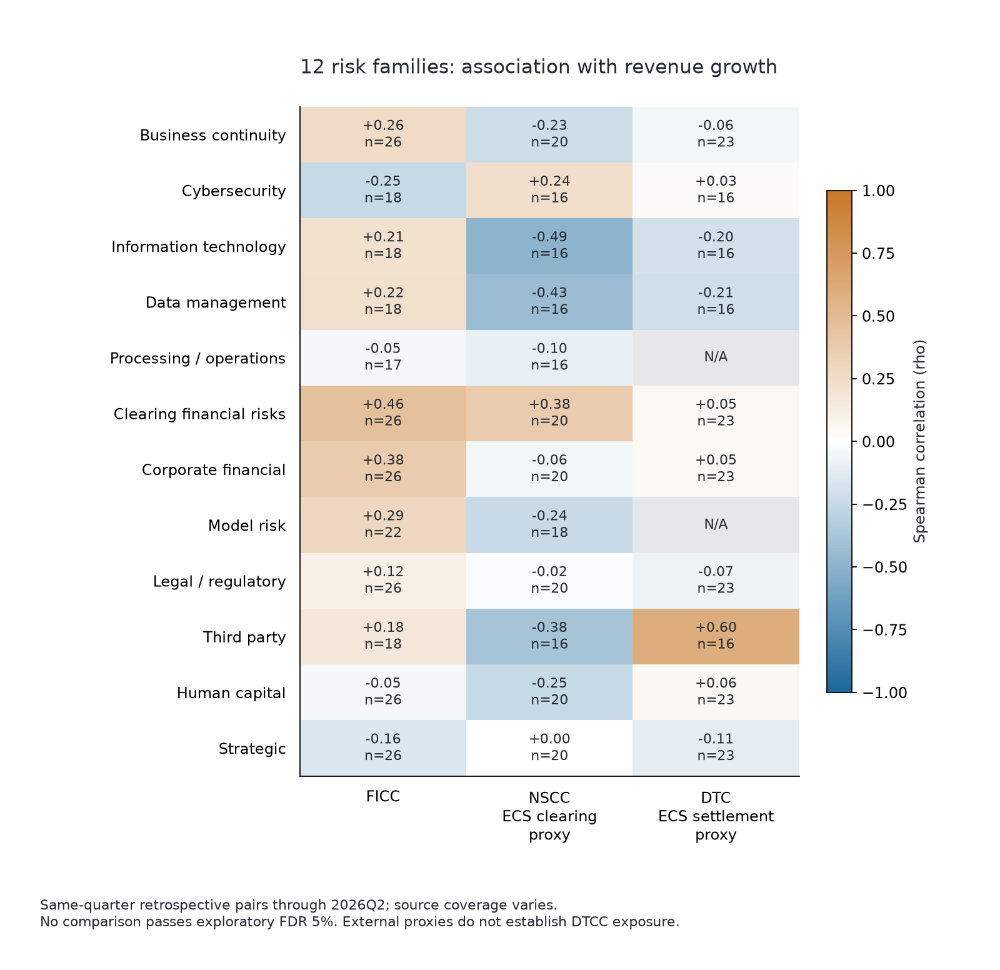
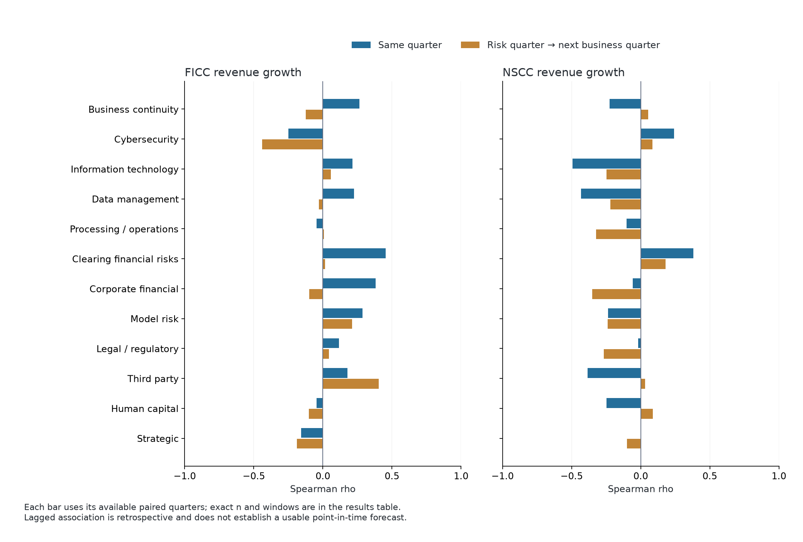
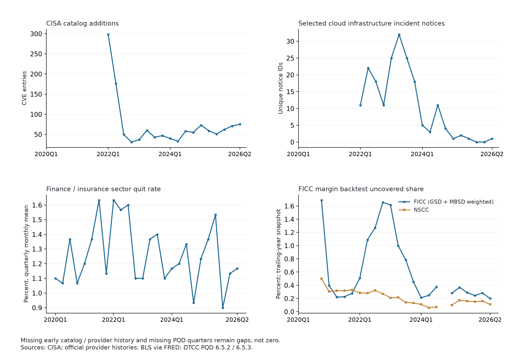

# FICC 与 ECS：十二类风险的公开数据关联分析

本次已为原始分类中的 **12 类风险**建立可量化指标，主指标和补充指标共 **20 种、26 条适用范围序列、572 条季度风险观测**。FICC 和 NSCC 均覆盖 12 类；DTC 覆盖 10 类。这里的“覆盖”表示有公开风险信号或代理变量可做探索，不表示已经取得该类风险的全部真实业务暴露。

新公开来源采集时间：**2026-10-05 20:13—2026-10-05 20:16，美国东部时间**；UTC 时间逐文件保存在来源清单。分析统一截止 **2026Q2**，最早外部数据从 2019Q1 开始，业务有效季度从 2020 年起。较新的原始记录保留在证据文件中，但未混入截至 2026Q2 的分析。

这次是扩大风险数据后的**关联研究**。全部 482 项同期或滞后比较均未通过探索性多重检验 5% 门槛。因此，下表可以用于提出后续验证问题，不能据此判定风险导致损失、给出损失概率或确定业务风险排名。

## 业务口径和“相关性”到底在比较什么

ECS 指 Equity Clearing & Settlement。公开报告没有可直接使用的独立 ECS 财务序列，本次分别使用 **NSCC 法人收入作为清算端代理、DTC 法人收入作为结算端代理**。二者的口径与 ECS 管理业务边界可能不同，不能机械加总，也没有用最大相关系数拼成 ECS 总分。

主表比较：风险主指标的季度值，与该业务**同季度收入环比增长率**的 Spearman 相关系数。收入环比增长率 =（本季度收入 / 上一日历季度收入 − 1）×100%。缺少前一季度收入时，该季度增长率保留缺失。

ρ 的范围是 −1 到 +1。正值表示风险指标高的季度通常也有较高收入增幅；负值表示风险指标高的季度通常收入增幅较低。它并不说明风险本身是好是坏，也不说明收入变化由该风险造成。交易活跃度、利率、费用政策和报告口径等都可能共同影响结果。n 是实际有双方数据的季度数。

## 十二类主指标及采集覆盖

每类先固定一个有公开历史且定义可追溯的主指标，再计算关联；没有按业务结果挑选绝对值最大的系数。其他指标在完整明细中保留。

| 风险类别 | 主指标 | 来源 | 有效风险季度 |
| --- | --- | --- | --- |
| 业务连续性 | 美国重大灾害宣告数量 | OpenFEMA DisasterDeclarationsSummaries v2 | 2019Q1—2026Q2；30期 |
| 网络安全与信息保护 | CISA已利用漏洞目录新增数量 | CISA Known Exploited Vulnerabilities catalog | 2022Q1—2026Q2；18期 |
| 信息技术 | 外部云计算与网络服务事件公告 | Google official product incident histories | 2022Q1—2026Q2；18期 |
| 数据管理 | 外部云数据服务事件公告 | Google official product incident histories | 2022Q1—2026Q2；18期 |
| 处理与运营 | 清算核心系统过去12个月故障数 | DTCC PQD 17.3.1 | 2021Q3—2025Q4；17期 |
| 清算与结算金融风险 | SOFR−EFFR季度最大利差 | FRED SOFR/EFFR | 2020Q1—2026Q2；26期 |
| 公司财务 | 三个月国债收益率波动 | FRED DGS3MO | 2019Q1—2026Q2；30期 |
| 模型风险 | 保证金模型回测未覆盖比例 | DTCC PQD 6.5.3 | 2020Q4—2026Q2；22期 |
| 法律与监管合规 | SEC/CFTC/美联储最终规则发布数量 | Federal Register API: SEC/CFTC/Federal Reserve RULE publications | 2019Q1—2026Q2；30期 |
| 第三方风险 | 外部办公服务提供商事件公告 | Google official product incident histories | 2022Q1—2026Q2；18期 |
| 人员与人力资本 | 金融保险行业主动离职率 | FRED JTU5200QUR | 2019Q1—2026Q2；30期 |
| 战略风险 | 美国经济政策不确定性 | FRED USEPUINDXM | 2019Q1—2026Q2；30期 |

来源与解释边界：

- 业务连续性使用 [OpenFEMA 灾害宣告数据](https://www.fema.gov/api/open/v2/DisasterDeclarationsSummaries)，先去除县级重复，再按宣告日期统计重大灾害。另保留排除生物类宣告的敏感性指标。全国宣告数无法识别某一 DTCC 场所受灾或停机。
- 网络安全使用 [CISA 已被利用漏洞目录](https://www.cisa.gov/sites/default/files/feeds/known_exploited_vulnerabilities.json)；dateAdded 是列入目录的日期。分析从 2022Q1 起，避开 2021 年目录启动的批量录入。没有 DTCC 软件资产清单，不能认定漏洞影响 DTCC。
- 信息技术、数据管理、第三方分别使用选定云基础设施、云数据服务、办公服务的官方历史服务事件公告。例如 [Compute Engine 历史](https://status.cloud.google.com/products/L3ggmi3Jy4xJmgodFA9K/history)、[Cloud SQL 历史](https://status.cloud.google.com/products/hV87iK5DcEXKgWU2kDri/history)、[Gmail 历史](https://www.google.com/appsstatus/dashboard/products/prPt2Yra2CbGsbEm9cpC/history)。共下载 11 个产品的多年历史页，不用仅覆盖近期的 JSON 倒推以前“没有故障”。同组按事件 ID 去重，IT 与数据组可能共享同一事件，不能相加。**尚未验证 DTCC 使用这些服务，这些只是外部环境代理。** 服务事件可包括中断、性能下降等，公告数量无法区分严重程度与影响范围；公告政策变化也可能改变序列。
- 处理与运营使用 DTCC PQD 17.3.1 过去 12 个月清算核心系统故障数；核心系统不可用比例 17.2.1 作为补充。共享清算系统不是每项业务独立事故数，也不覆盖全部手工处理错误。DTC 没有适用主指标，所以留空。
- 模型风险使用 DTCC PQD 6.5.3 的保证金回测未覆盖比例 = 100% − 覆盖率。FICC 按 GSD、MBSD 的 6.5.2 回测观察数加权汇总，明确为研究计算；各部门原值和单元格证据均保留。该指标是模型表现信号，不是模型设计错误或实际损失标签。DTC 没有对应清算保证金回测指标。
- 清算金融风险主指标是 [SOFR](https://fred.stlouisfed.org/series/SOFR) 与 [EFFR](https://fred.stlouisfed.org/series/EFFR) 的季度最大利差，另有市场波动、长端利率与信用条件变化。它们均是外部市场信号，不等于会员违约或保证金缺口。
- 公司财务的跨业务主指标是 [美联储三个月国债收益率 DGS3MO](https://fred.stlouisfed.org/series/DGS3MO) 的季度日度标准差，原单位为百分点，作为现金再投资环境信号。另从 PQD 15.1.1/15.1.2 提取自有流动净资产与半年运营费用的比值，提供更接近公司自身的补充分析。
- 法律监管使用 [Federal Register 官方接口](https://www.federalregister.gov/reader-aids/developer-resources/rest-api) 中 SEC、CFTC、Federal Reserve 发布的最终规则；它包含行政类和其他金融业务规则。517 条文档与接口总数一致；规则数量只代表变化活动，不是合规违规严重度。
- 人力资本使用美国劳工统计局经 FRED 发布的 [金融保险行业主动离职率 JTU5200QUR](https://fred.stlouisfed.org/series/JTU5200QUR)。它不是 DTCC 员工流失率，原序列未经季调，另做季度季节性调整。
- 战略使用 Baker、Bloom、Davis 编制并经 FRED 发布的 [美国经济政策不确定性 USEPUINDXM](https://fred.stlouisfed.org/series/USEPUINDXM)，补充美联储货币政策公告数。它是战略环境信号，不能替代具体项目失败或竞争指标。

## 同期收入关联：全类别汇总

| 风险类别 | FICC | NSCC：ECS清算端 | DTC：ECS结算端 |
| --- | --- | --- | --- |
| 业务连续性 | +0.264（n=26） | -0.226（n=20） | -0.061（n=23） |
| 网络安全与信息保护 | -0.249（n=18） | +0.241（n=16） | +0.026（n=16） |
| 信息技术 | +0.214（n=18） | -0.495（n=16） | -0.195（n=16） |
| 数据管理 | +0.225（n=18） | -0.432（n=16） | -0.209（n=16） |
| 处理与运营 | -0.046（n=17） | -0.101（n=16） | N/A：缺少适用指标 |
| 清算与结算金融风险 | +0.455（n=26） | +0.380（n=20） | +0.048（n=23） |
| 公司财务 | +0.381（n=26） | -0.059（n=20） | +0.052（n=23） |
| 模型风险 | +0.287（n=22） | -0.235（n=18） | N/A：缺少适用指标 |
| 法律与监管合规 | +0.116（n=26） | -0.017（n=20） | -0.074（n=23） |
| 第三方风险 | +0.177（n=18） | -0.385（n=16） | +0.597（n=16） |
| 人员与人力资本 | -0.046（n=26） | -0.248（n=20） | +0.062（n=23） |
| 战略风险 | -0.156（n=26） | +0.003（n=20） | -0.110（n=23） |

N/A 是业务适用指标缺失，不是相关性为零。各行的有效时期不同，不能仅凭绝对值大小做跨类别风险排名。

## 哪些线索值得继续验证

NSCC 的技术服务事件代理与收入增幅同期 ρ = −0.495（16 个季度），数据服务事件代理为 −0.432（16 个季度）。两者的分块重抽样区间均跨过零；控制季节和趋势后绝对值下降到约 0.21。这意味着负相关是一个线索，但统计支持还不足。

DTC 与办公服务事件公告同期为 +0.597，下一季度则为 −0.391。不能解释成“服务事件让 DTC 更赚钱”。没有供应商关系证据，且不同时间配对的方向不稳定。

FICC 的短期国债收益率波动同期为 +0.381，下一季度为 −0.099。金融压力可能同时伴随交易需求变化；收入上升也不代表结算安全风险下降。

| 业务/指标 | 配对 | n | 原始ρ | 季节/趋势调整ρ | 95%分块重抽样区间 |
| --- | --- | --- | --- | --- | --- |
| DTC/外部办公服务提供商事件公告 | 同期 | 16 | +0.597 | +0.444 | [+0.214, +0.849] |
| DTC/外部办公服务提供商事件公告 | 风险→下一季度 | 15 | -0.391 | -0.439 | [-0.779, +0.199] |
| FICC/三个月国债收益率波动 | 同期 | 26 | +0.381 | +0.408 | [-0.147, +0.725] |
| FICC/三个月国债收益率波动 | 风险→下一季度 | 26 | -0.099 | -0.159 | [-0.445, +0.165] |
| NSCC/外部云数据服务事件公告 | 同期 | 16 | -0.432 | -0.211 | [-0.785, +0.312] |
| NSCC/外部云数据服务事件公告 | 风险→下一季度 | 15 | -0.220 | +0.540 | [-0.786, +0.493] |
| NSCC/外部云计算与网络服务事件公告 | 同期 | 16 | -0.495 | -0.214 | [-0.704, +0.183] |
| NSCC/外部云计算与网络服务事件公告 | 风险→下一季度 | 15 | -0.248 | +0.541 | [-0.795, +0.382] |

## 同一组季度复核

为避免“每一类在不同年份比较”误导，另使用所有可用主指标和三项业务收入共有的 12 个季度：2022Q1, 2022Q2, 2022Q3, 2023Q2, 2023Q3, 2023Q4, 2024Q1, 2024Q2, 2024Q3, 2025Q1, 2025Q2, 2025Q3。这些季度并不连续，因此结果仍是一个子样本敏感性检查。

| 风险类别 | FICC：相同12季度ρ | NSCC：相同12季度ρ | DTC：相同12季度ρ |
| --- | --- | --- | --- |
| 业务连续性 | +0.365 | -0.305 | -0.133 |
| 网络安全与信息保护 | -0.147 | +0.056 | +0.000 |
| 信息技术 | -0.112 | -0.415 | -0.281 |
| 数据管理 | -0.035 | -0.404 | -0.292 |
| 处理与运营 | -0.208 | -0.079 | N/A |
| 清算与结算金融风险 | +0.501 | +0.357 | +0.368 |
| 公司财务 | +0.077 | -0.497 | +0.217 |
| 模型风险 | -0.084 | -0.126 | N/A |
| 法律与监管合规 | -0.135 | -0.244 | +0.439 |
| 第三方风险 | +0.231 | -0.224 | +0.623 |
| 人员与人力资本 | -0.151 | -0.235 | -0.021 |
| 战略风险 | +0.028 | +0.042 | +0.266 |

NSCC 的技术、数据服务代理在共同季度内仍分别为 −0.415、−0.404；FICC 对应系数则由全可用期的正值变成小负值。公司财务主代理与 NSCC 的系数由 −0.059 变为 −0.497。**样本选择明显影响结果，当前不能把相关系数当作稳定的风险传导参数。**

## 补充的公司自身财务信号

半年运营费用 / 自有流动净资产，比值越高表示流动净资产对这项费用尺度的缓冲相对较小。仅使用注释明确为季度末的 2023Q1—2026Q2 记录，共 13 个季度，早期重复的年度值已剔除。这是内生财务状态指标，费用本身也与盈利机械相关，不能用作独立外生冲击。

| 业务 | 配对 | ρ | n |
| --- | --- | --- | --- |
| FICC | 同期 | +0.341 | 13 |
| FICC | 风险→下一季度 | +0.524 | 12 |
| NSCC | 同期 | +0.182 | 11 |
| NSCC | 风险→下一季度 | -0.261 | 10 |

## 完整分析包括什么

除了主表中的收入，完整明细还比较了 FICC、NSCC、DTC 的运营利润率变化和净利润率变化；以及 FICC/GSD、FICC/MBSD 的日均交易名义额和交易笔数增幅，共 13 条业务序列。482 条结果包含每项指标的同期和下一季度关系，提供 Pearson、Spearman、配对季度数、时期、区间、调整后系数以及解释边界。

分析先补齐完整日历季度，再移动风险一季度，避免跨越缺失期错配。双方缺失均不插值、不前向填充。每项比较至少要求 8 个季度和 3 个不同值；少于 12 个季度的结果视为样本有限。风险 t 与业务 t+1 的关系是回顾性关联，历史数据使用本次采集版本，尚未建立严格的当时可得数据版本，不能宣称具有可用预测效果。

区间采用 2,000 次配对的 4 季度循环分块重抽样；另做季度季节性与线性趋势调整、逐年剔除、剔除 2020 年、指标差分检查。过去 12 个月滚动指标使用隔年差分检查重叠窗口影响。循环平移作为探索性参考，再对 482 项比较做 BH 多重检验修正；所有结果均未达到 5% 门槛。季度样本很少，循环平移参考分辨率低，未通过也不能证明风险没有影响。

## 当前完成与仍需补充的部分

已完成：12 类公开数据指标、20 种主/补充指标、可复现的 482 项关联研究、共同季度复核、原始证据与单元格来源保存。新增成功下载 23 份公开来源文件，复用 22 份已有 PQD 工作簿。部分故障历史、PQD 季度和财务季度有缺失，均在覆盖表中明确保留。

尚不能完成的结论：每类风险造成多少实际损失、DTCC 使用了事件涉及的哪些服务、哪些软件漏洞确实暴露、真实员工流失的业务影响，以及因果风险分数。这些分别需要供应商/软件资产对应表、事故和影响记录、人员数据、业务暴露及损失或违约标签。没有这些数据时，公开代理的相关性不能替代直接业务证据。

全部主指标、三项业务收入都齐全的共同样本只有 12 个季度，因此没有把全部风险塞进同一个机器学习模型。那样很容易过拟合。当前结果更适合筛选后续数据需求和验证问题。原来的金融风险监测分数保留，**没有重新标为十二类综合风险评分**。

## 文件索引

- `Twelve_Risk_Families_FICC_ECS.ipynb`：已从新内核运行的中文分析 notebook，带完整表格与三张图；HTML 为其导出版本。
- `results/十二类风险_收入关联汇总.csv`：可直接用 Excel 打开的中文主表。
- `results/expanded_risk_business_associations.csv`：482 条完整结果，包括同期/滞后、全部业务指标及稳健性检查。
- `results/common_calendar_revenue_associations.csv`：统一季度的复核结果。
- `data/expanded_risk_dictionary.csv`、`data/collection_coverage.csv`：20 种风险指标的定义、适用范围、覆盖期和限制。
- `data/expanded_risk_observations.csv`、`data/expanded_analysis_panel.csv`：季度风险值与完整配对表，缺失保留为空。
- `source_manifest.json`、`history_products.json`、`reused_input_manifest.json`：下载来源、时间、文件哈希、产品选择及复用记录。
- `data/pqd_risk_cell_evidence.csv`：PQD 文件、工作表、行和列的来源证据。

所有原有中文/英文说明和原有模型文件均保留，本次内容位于新的 `risk_category_expansion` 文件夹。
